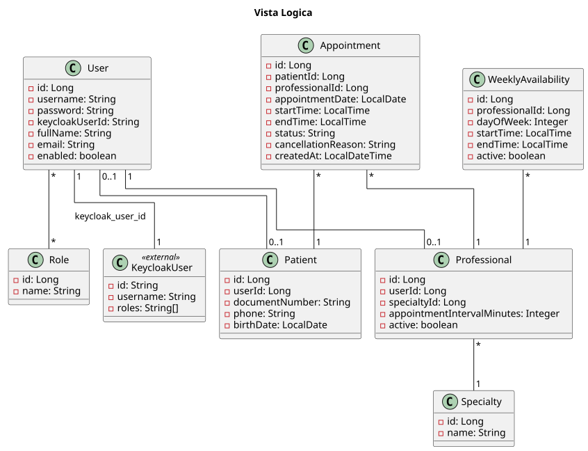
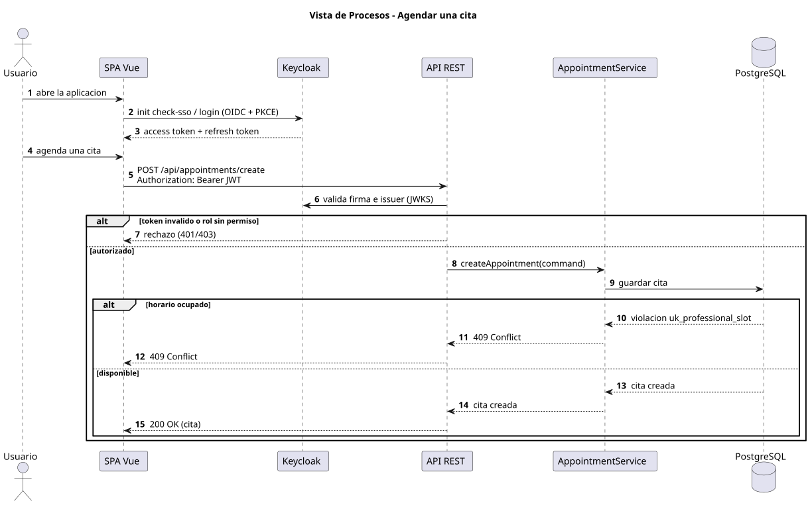
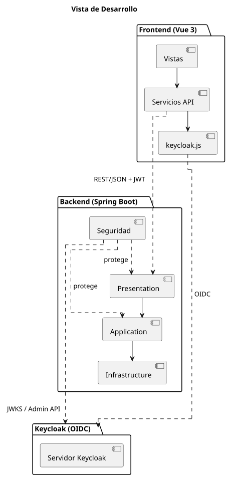
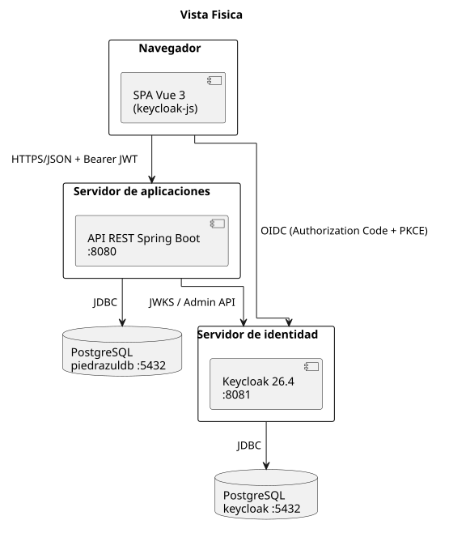
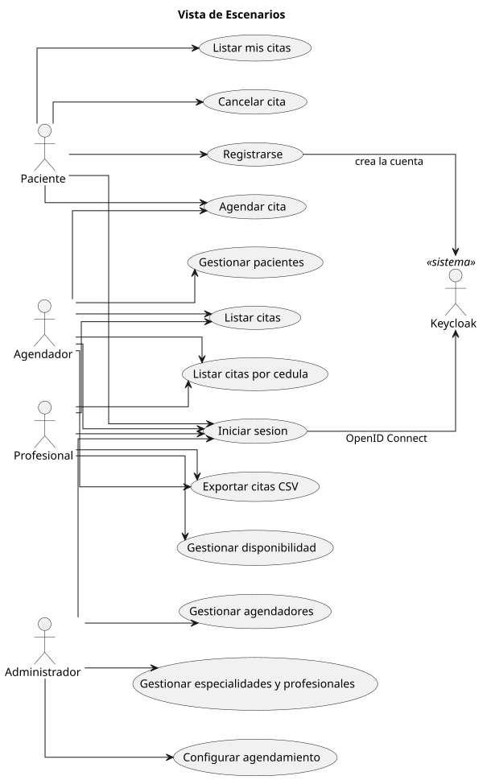

# Vistas de arquitectura 4 + 1

Diagramas de arquitectura de Piedrazul organizados según el modelo 4 + 1. Cada vista incluye su fuente PlantUML y exportaciones SVG y PNG.

Las vistas reflejan la arquitectura actual con Keycloak como servidor de identidad (OIDC) y una base de datos independiente para Keycloak. Los diagramas de clases, despliegue y desarrollo usan `!pragma layout elk` y `skinparam linetype ortho` para trazar líneas ortogonales; la vista de escenarios usa Graphviz con `skinparam linetype ortho`. Se recomienda PlantUML 1.2025.x o superior.

## Vista lógica

## Vista de procesos

## Vista de desarrollo

## Vista física

## Escenarios

