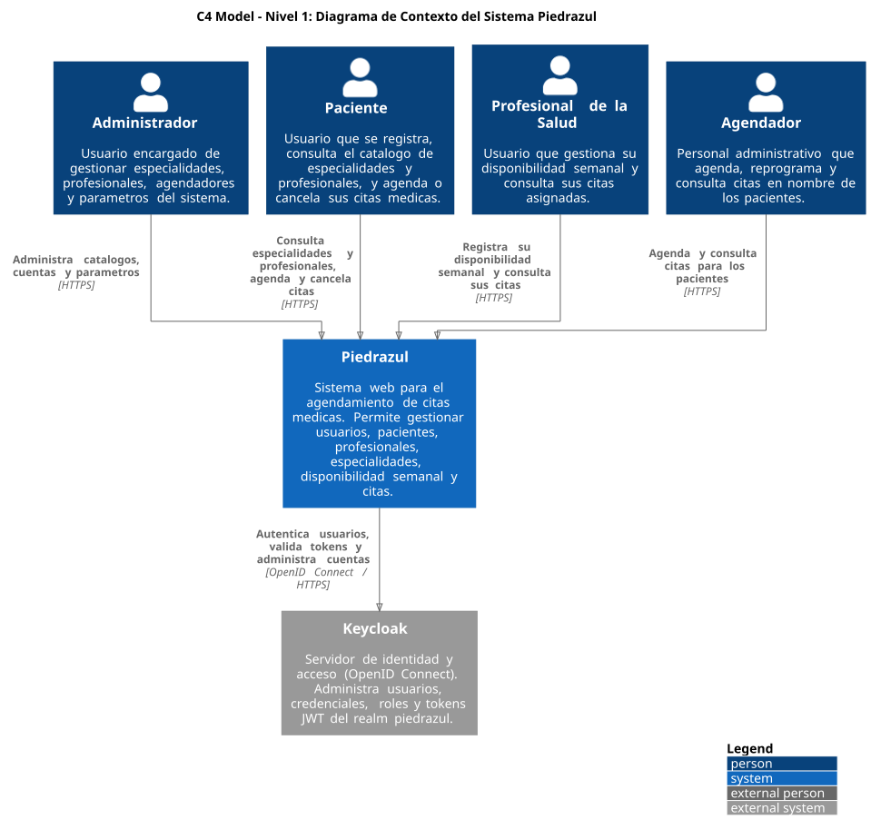
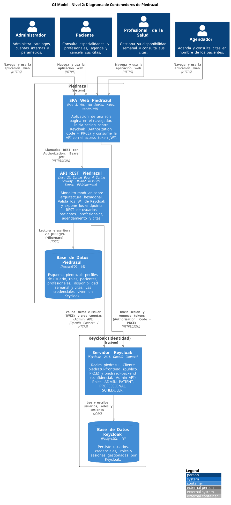
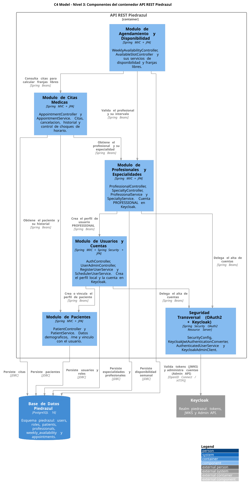
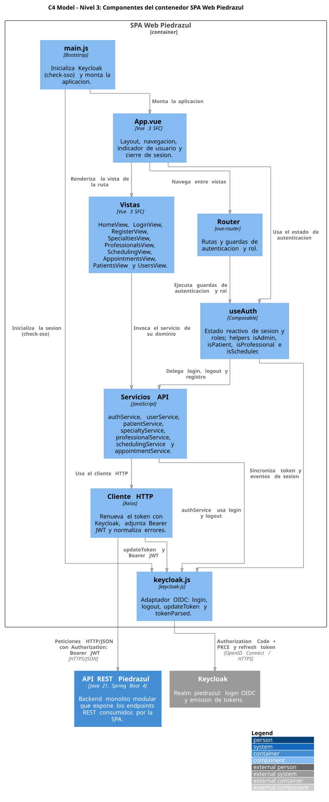
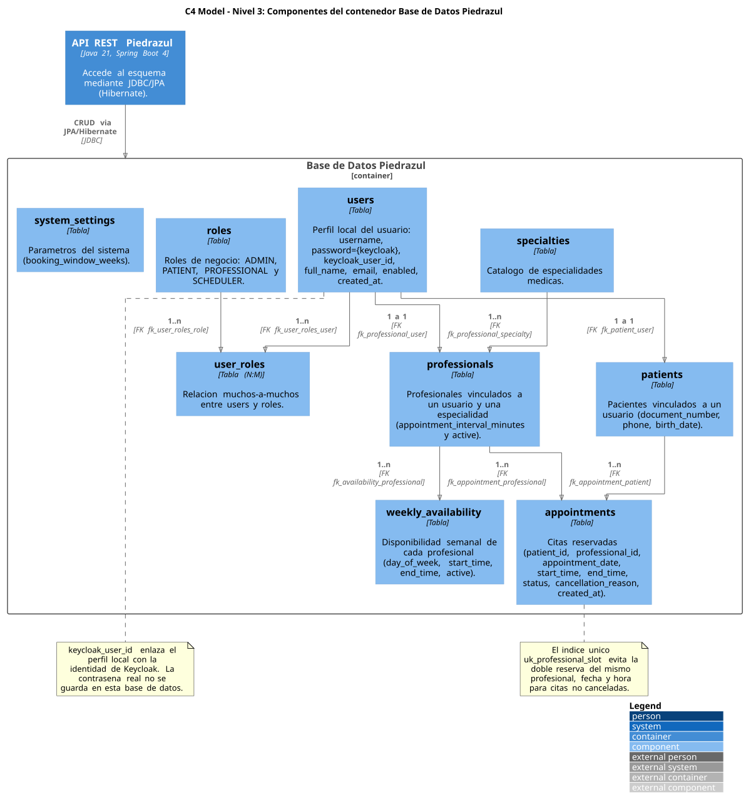
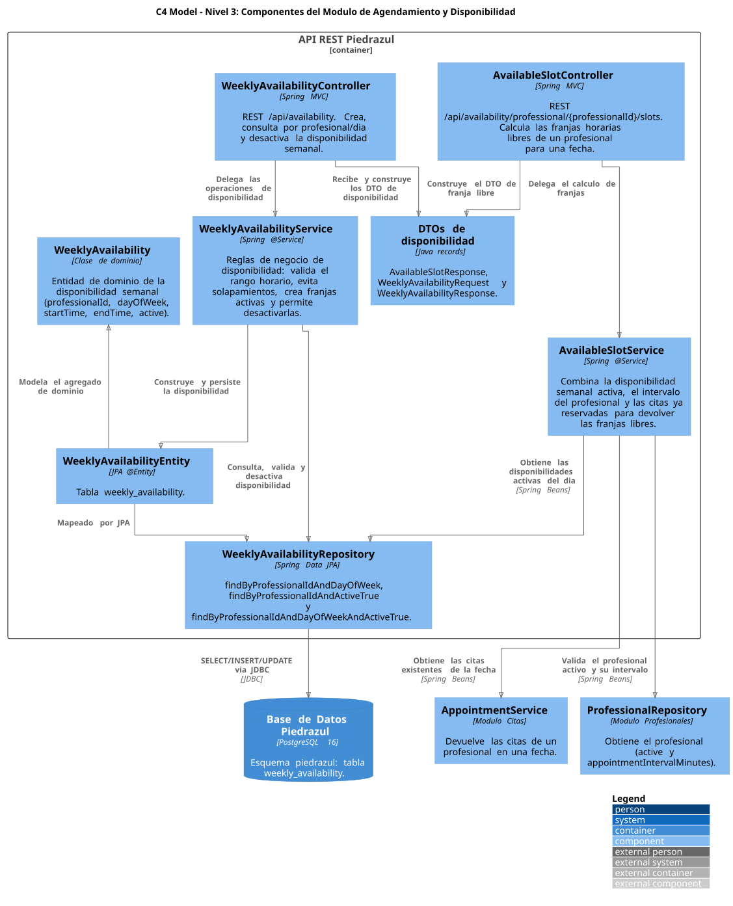
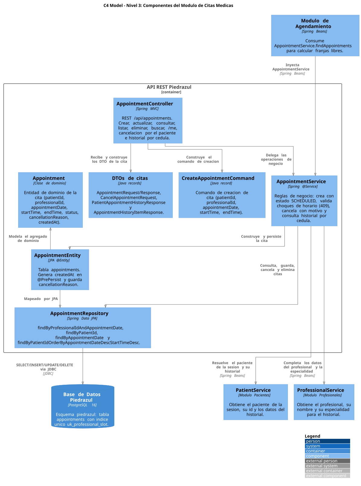
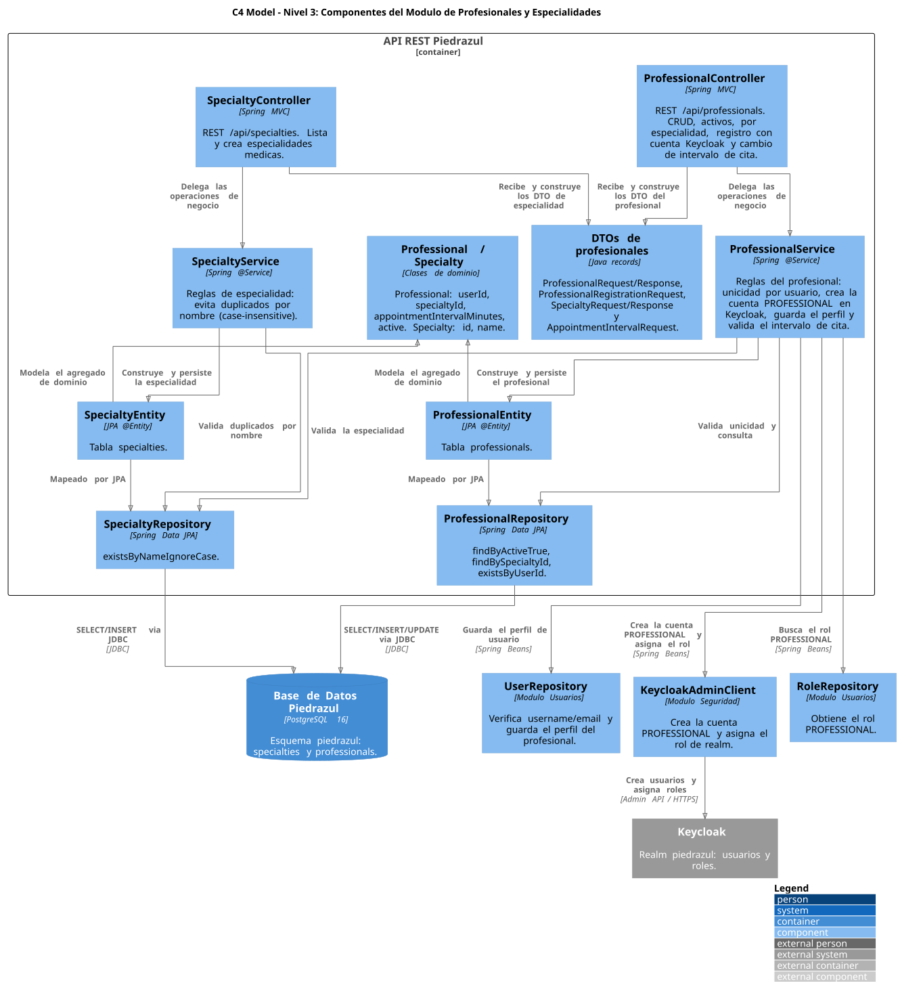
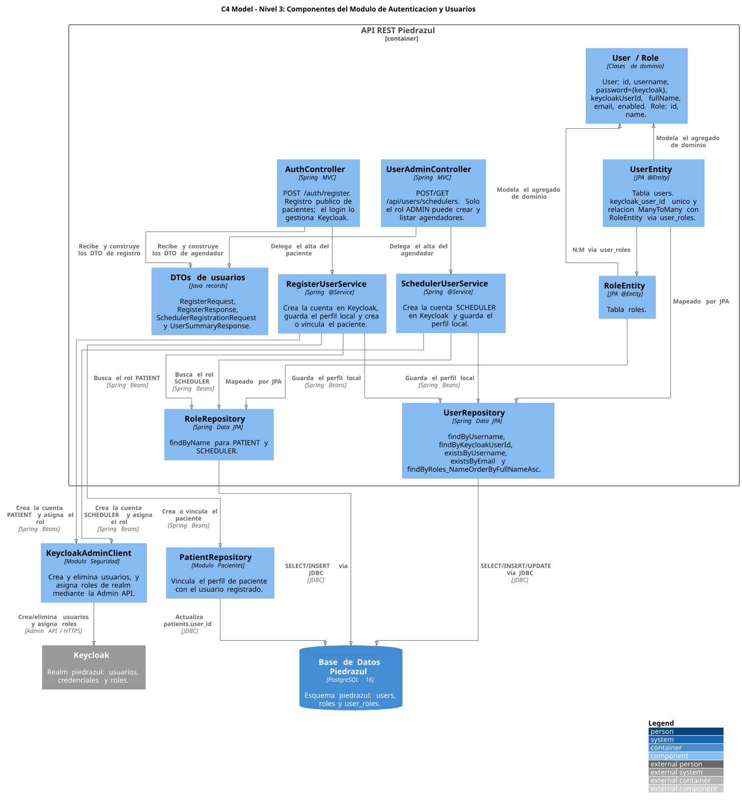
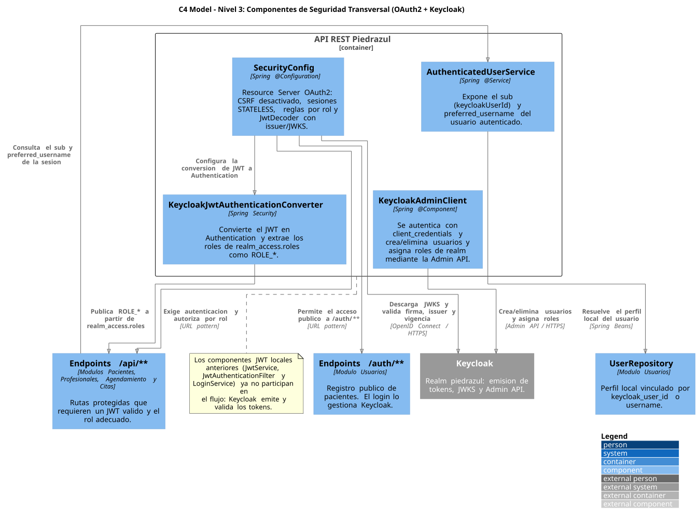

# Modelo C4 - Piedrazul Monolito Modular

Documentacion de arquitectura usando el modelo C4.

> Los diagramas incluyen Keycloak como proveedor de identidad (OpenID Connect) y su propia base de datos. Las fuentes `.puml` usan `!pragma layout elk` y `skinparam linetype ortho` para obtener rutas ortogonales; se recomienda PlantUML 1.2025.x o superior con Graphviz instalado. Los SVG de este directorio se generan a partir de esos archivos.

## 1. Contexto del Sistema

## 2. Contenedores

## 3. Componentes
### Backend

### Frontend

### Base de Datos

### Modulo Agendamiento

### Modulo Citas

### Modulo Profesionales

### Modulo Usuarios

### Seguridad

